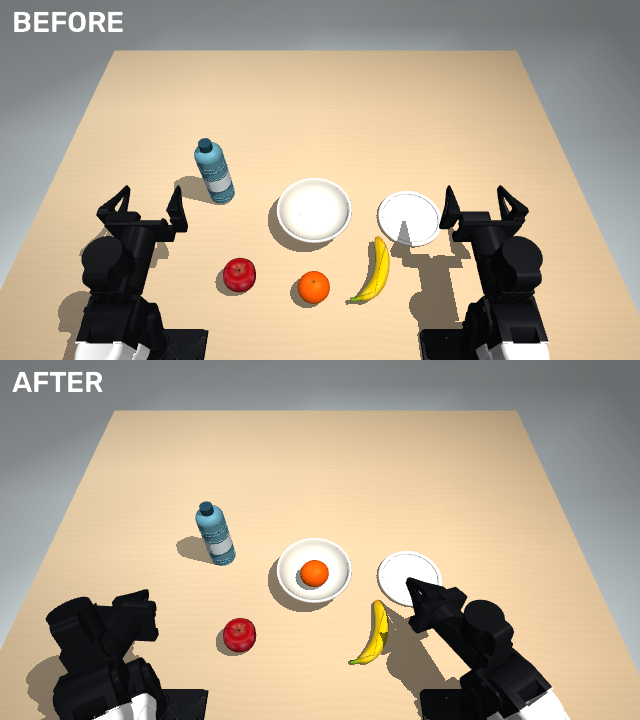
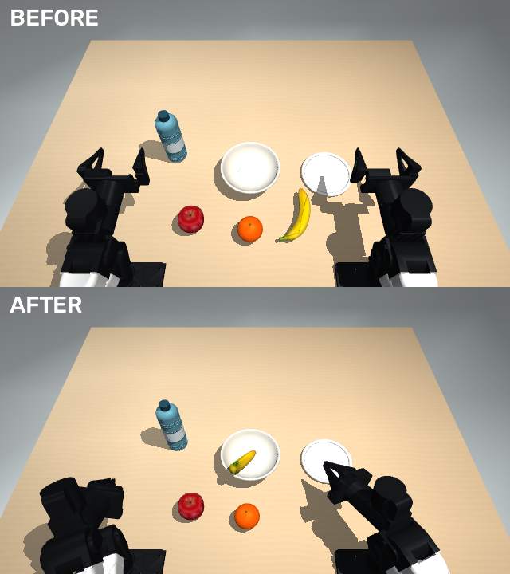
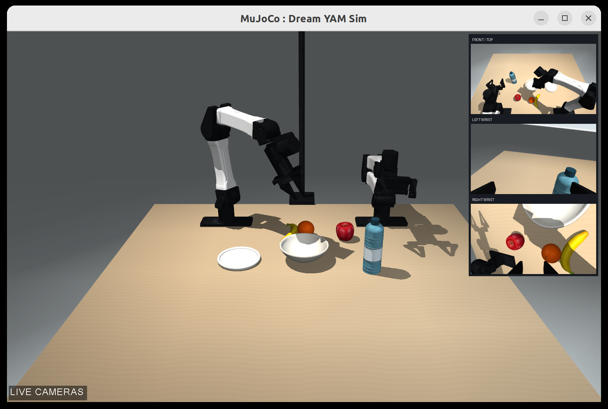
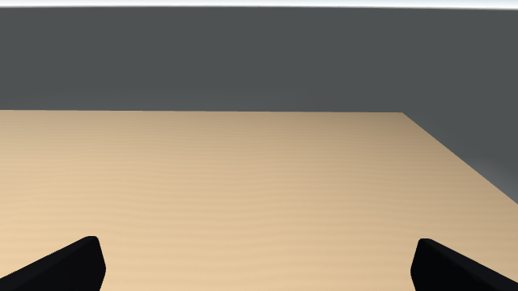

# Dream-1 × YAM in MuJoCo — Bimanual Manipulation Trials

Recorded, measured trials of **Dream Labs' Dream-1** driving a simulated **I2RT YAM bimanual arm** in MuJoCo, plus the Isaac Sim tooling built along the way to drive Dream-1 from other simulators.

<p align="center">
  
  
</p>
<p align="center"><em>Two successful pick-and-place runs. Top: scene before the trial. Bottom: after Dream-1 finished. Left: "put orange into the bowl". Right: "put banana into the bowl".</em></p>

Every trial is a **real model run**: Dream-1 receives camera images, the arm state and a text instruction, and returns the joint targets itself. Nothing in the motion is scripted. Success is decided afterwards from MuJoCo body poses, never from anything the model says about itself.

---

## Contents

1. [What is Dream-1?](#what-is-dream-1)
2. [Results](#results)
3. [Successful grasps](#successful-grasps)
4. [How the code works](#how-the-code-works)
5. [How a trial is scored](#how-a-trial-is-scored)
6. [Repository layout](#repository-layout)
7. [Setup and running](#setup-and-running)
8. [Budget control](#budget-control)
9. [Honest limitations](#honest-limitations)

---

## What is Dream-1?

[Dream Labs](https://dreamlabs.ai/research/dream-1/) released **Dream-1** in October 2026 as a hosted robot foundation model behind a public API (from about $3 per hour of robot time).

- **World Action Model.** It learns how scenes change from video and links that to arm motion, so predicting what the robot should do and imagining what will happen are treated as one problem. It builds on the team's earlier DreamZero research.
- **Zero-shot to new robots.** It was trained on a single robot, the I2RT **YAM**, and is meant to control other bimanual robots with parallel grippers without fine-tuning or demonstrations from that robot.
- **Simple interface.** You send camera frames, the robot state and a natural-language task. You get back the next ~1.6 s of actions as end-effector poses, which a client-side IK solver converts to joint targets for your arm.
- **Scope.** A manipulation policy for bimanual parallel-gripper robots. Dream Labs describes it as a research beta, not validated for safety-critical use.

This repo uses Dream-1 on its native YAM arms (MuJoCo example shipped with the Dream CLI) and, separately, wires it into Isaac Sim.

---

## Results

Model: `dreamlabs/dream-1-beta`. Fresh scene per trial, GUI open, viewer window recorded.

| # | Task | Time | Verdict | Measurement |
|---|------|------|---------|-------------|
| 1 | put apple into the bowl | 240 s | FAIL | xy 11.6 cm (limit 6) |
| 2 | put banana on the plate | 240 s | FAIL | xy 20.9 cm (limit 7) |
| 3 | put orange into the bowl | 240 s | **SUCCESS** | xy 0.2 cm, dz +3.7 cm |
| 4 | put apple on the plate | 240 s | FAIL | xy 34.9 cm (limit 7) |
| 5 | put banana into the bowl | 300 s | **SUCCESS** | xy 2.7 cm, dz +6.0 cm |
| 6 | put orange on the plate | 240 s | FAIL | pose drift, xy 832 cm |
| 7 | apple→bowl + banana→plate | 300 s | ERROR | Dream API unreachable at the time |
| 8 | orange→plate + apple→bowl | 300 s | FAIL | apple xy 39.6 cm (limit 6) |

**2 successes out of 8 trials** (single-object bowl placements). Plate trials failed on centring; one trial hit an API outage; trial 6 shows simulation pose drift. Additionally, **both4** (bimanual banana→plate + apple→bowl with assisted grip) succeeded with the new `--hold-grip` and `--assist-descent` flags. Full details are in [`tasks_report.txt`](tasks_report.txt).

---

## Successful grasps

### Orange into the bowl (trial 3, 240 s)

The orange starts on the table between the arms. After the run it sits in the bowl, 0.2 cm from the bowl centre.


Live viewer capture with the three camera feeds (front/top, left wrist, right wrist) in the side panel:


Video: [`yam_check/video/put_orange_into_the_bowl_1_a3.mp4`](yam_check/video/put_orange_into_the_bowl_1_a3.mp4)

### Banana into the bowl (trial 5, 300 s)

A longer, harder reach. The banana ends in the bowl, 2.7 cm from the centre, resting 6.0 cm above the bowl reference.




Video: [`yam_check/video/put_banana_into_the_bowl_1_a5.mp4`](yam_check/video/put_banana_into_the_bowl_1_a5.mp4)

### Reference camera views

The three cameras Dream-1 sees each step: overhead (head), left wrist and right wrist.

<p align="center">
  
  
  
</p>

---

### Both4 bimanual success (trial with --hold-grip and --assist-descent)

Banana → plate and apple → bowl, both placed successfully, gripper released at the end.

| Metric | Value |
|---|---|
| Tasks | pick up the banana and put it on the plate, then pick up the apple and put it in the bowl |
| Verdict | SUCCESS |
| Banana → plate | xy 1.8 cm (limit 7), dz +4.1 cm, placed |
| Apple → bowl | xy 0.0 cm (limit 6), dz +4.5 cm, placed |
| Grasp contacts | left 128x right 135x, objects banana, apple |
| Scripted assist | descent 4 mm applied 312x left / 1047x right | grip latched True left / True right (345/312 steps held shut), released 1x |
| Elapsed | 208s (GUI), seconds 245 |
| Video | [`yam_check/video/both4_reencoded.mp4`](yam_check/video/both4_reencoded.mp4) (7 MB, 1280 px) |
| Proof images | [`before_top.png`](yam_check/trials/pick_up_the_banana_and_put_it_on_the_plate_then_pick_up_the_apple_and_put_it_in_the_bowl_1_both4_before_top.png) / [`after_top.png`](yam_check/trials/pick_up_the_banana_and_put_it_on_the_plate_then_pick_up_the_apple_and_put_it_in_the_bowl_1_both4_after_top.png) / [`gui.png`](yam_check/trials/pick_up_the_banana_and_put_it_on_the_plate_then_pick_up_the_apple_and_put_it_in_the_bowl_1_both4_gui.png) |

This is the one that works with the assisted grip (descent + hold/release). |

## How the code works

There are two independent pipelines in this repo.

### Pipeline A: MuJoCo trials (the results above)

```
yam_trials.py
   │  builds yam_env.YamEnv()        (scene: 2 YAM arms, table, apple/orange/banana, bowl, plate, bottle)
   │  optional boost_grasp(env)      (stronger finger force and friction, physics only)
   │  records poses → "pre"
   ▼
dream_control.main(argv, shared_env=env)      ← Dream's own control loop
   │  sends: 3 camera frames + arm state + task text  ──►  Dream-1 API
   │  receives: action chunk (end-effector poses → joint targets via client IK)
   │  executes at ~20 Hz with Dream's action validation
   ▼
yam_trials.py
   │  records poses → "post"
   │  evaluate(task, pre, post)  → SUCCESS / FAIL
   │  saves before/after PNGs, proof sheet, GUI screenshot, mp4, report entry
```

Key pieces in [`yam_trials.py`](yam_trials.py):

| Function / class | What it does |
|---|---|
| `poses(env)` | Reads world positions of the three fruits, bowl and plate from MuJoCo body state. |
| `boost_grasp(env)` | Raises finger actuator force limit to ±40 N (stock ±22) and finger-pad friction to 2.5 (stock 1.6). Sim physics only; it does not move the arm. |
| `evaluate(task, pre, post)` | Parses fruit and receptacle from the task text, measures `dxy`, `dz`, and decides success against the receptacle radius. |
| `Recorder` | Watches the X tree for the new MuJoCo viewer window, records it with `ffmpeg x11grab` at 10 fps, and takes a mid-trial GUI screenshot. |
| `contact_sheet(...)` | Stacks the before and after top-camera frames into the `_proof.png` image. |
| `grasp_probe(env)` | Wraps `env.step` and counts finger↔fruit contacts while a gripper is closing (diagnostic, see limitations). |
| `main()` | CLI: loops tasks and trials, resets the scene, runs the Dream loop, scores, saves artefacts, appends to the report. |

### Pipeline B: Isaac Sim bridge (dual Franka and YAM import)

Isaac Sim ships its own Python (3.11), while the Dream client lives in a separate environment (3.12). A localhost socket bridges them:

```
Isaac Sim process (python.sh)                    dream-env process (Python 3.12)
run_dream1_isaac.py / run_yam_isaac.py   ◄────►  dream_bridge.py  ──►  Dream-1 API
  scene + 3 cameras                      127.0.0.1:6006               budget.Ledger (spend cap)
  executes returned chunks               multiprocessing.connection   dashboard.py (Tk UI)
```

Message protocol between the two (`dream_bridge.py`):

| Command | Meaning |
|---|---|
| `reset` | Start a new episode on the Dream client. |
| `obs` | Send camera frames (as `video.<role>`), joint state and the prompt. |
| `act` | Charge the ledger, call `get_action`, return `q_r_chunk` and `q_l_chunk` (48 rows = 1.6 s each). Cold models answer `pool_warming`; the bridge waits and retries without being billed. |
| `quit` | Close the connection. |

Supporting modules:

- [`embodiment_config.py`](embodiment_config.py): builds the `policy()` config, including the body layout (6 joints per arm for YAM, 7 for Franka) and the `ik` block that makes the client convert end-effector poses to joints.
- [`budget.py`](budget.py): per-call ledger (`cap_usd`, `max_calls`), charged *before* every paid request so failures still count.
- [`tasks.py`](tasks.py): task table for the dual-Franka tabletop scene (red/blue cubes, green/yellow bins).
- [`dashboard.py`](dashboard.py): Tk dashboard with the three camera feeds, robot state, ledger and logs.
- [`find_yam_home.py`](find_yam_home.py), [`test_yam_import.py`](test_yam_import.py), [`test_yam_import2.py`](test_yam_import2.py): import the YAM URDF into Isaac Sim, find a good home pose, and export `yam_left.usd`, `yam_right.usd`, `yam_probe.usd`.
- [`check_setup.py`](check_setup.py): free preflight (API key, checkpoint, arm file, IK build, ledger). Makes no inference calls.

---

## How a trial is scored

- `dxy`: horizontal distance between the fruit body and the receptacle body (m, shown in cm).
- `dz`: vertical offset of the fruit above the receptacle body.
- **Placement success:** `dxy < radius` and `-0.04 < dz < 0.12`, with bowl radius 0.060 m and plate radius 0.070 m.
- For two-object tasks, the first named fruit and receptacle are judged.
- Success is measured from simulator state after the run, not from the model's output.

---

## Repository layout

```
yam_trials.py            trial driver: GUI, threaded recorder, grasp boost, grasp probe, scoring
yam_budget_runner.py     time-based budget wrapper for `dreamcli example yam-mujoco`
budget.py                per-call credit ledger used by the bridge
yam_ledger.json          time ledger (seconds run, cap, rate, estimated spend)
dream_bridge.py          Isaac ↔ Dream socket bridge
embodiment_config.py     Dream policy/embodiment config (YAM 6 DoF, Franka 7 DoF)
run_dream1_isaac.py      Isaac Sim dual-Franka scene driven by Dream-1
run_yam_isaac.py         Isaac Sim scene with Dream's own YAM arms
dashboard.py             Tk operator dashboard
tasks.py / tasks.txt     task tables (Isaac scene / MuJoCo prompts)
check_setup.py           free preflight check
find_yam_home.py, test_yam_import*.py   YAM URDF import utilities
yam_left/right/probe.usd YAM arm assets for Isaac
run_isaac_clean.sh       Isaac python with a scrubbed environment
run_yam_demo.sh          launch Dream's YAM sim through the budget wrapper
kill_isaac.sh            kill leftover Isaac runs and bridges
tasks_report.txt         verdicts, measurements, spend, notes
yam_check/video/         one .mp4 per trial (GUI capture)
yam_check/trials/        *_before_top, *_after_top, *_proof, *_gui PNGs
yam_check/frames/        reference top / left / right camera frames
gh_upload.py, UPLOAD_NOTES.md   how artefacts were pushed to GitHub
```

---

## Setup and running

Requirements: a Dream API key (stored by the Dream CLI in `~/.dreamlabs/credentials`), the `dream` Python package with its `dream_examples/yam_mujoco` example, MuJoCo, `ffmpeg`, ImageMagick (`import`, `xwininfo`) and an X display for the GUI capture. Paths in the scripts assume a `~/dream-env` virtualenv; adjust `EXAMPLE` in `yam_trials.py` to your install.

**Run one MuJoCo trial with GUI and recording:**

```bash
export DISPLAY=:1
MUJOCO_GL=glx ~/dream-env/bin/python yam_trials.py \
    --viewer \
    --video-dir yam_check/video \
    --report tasks_report.txt \
    --task "put orange into the bowl" \
    --seconds 240 \
    --grasp-boost
```

Useful flags: `--task` (repeatable), `--trials`, `--actions`, `--tag`, `--frames`, `--grasp-boost`.

**Free preflight (no credits spent):**

```bash
~/dream-env/bin/python check_setup.py
```

**Isaac Sim with Dream's YAM arms (two terminals):**

```bash
# terminal 1 (dream-env)
python dream_bridge.py --arm yam --cap-usd 5 --max-calls 300

# terminal 2
./run_isaac_clean.sh run_yam_isaac.py --max-calls-per-ep 60
```

Use `python dream_bridge.py --mock` and `--dump-frames` for free dry runs.

---

## Budget control

Two independent brakes protect the account:

- `yam_budget_runner.py` bounds MuJoCo sessions by **time** at $3/h against a hard $5.00 cap and refuses to start past it. `yam_ledger.json` is the source of truth (currently 4,681 s, about $3.90 estimated).
- `budget.py` bounds Isaac sessions per **call** (`cap_usd` and `max_calls`); one call returns 1.6 s of actions, roughly $0.0013.

---

## Honest limitations

- Only 2 of 8 tasks succeeded. Dream-1 handles bowl placement with a clean approach, and is weaker at centring over the smaller plate target.
- The grasp probe usually counts 0 finger↔object contacts even when the object visibly moves, with or without the boost. Contact counts are not reliable evidence of a grasp here; the pose measurements and the videos are.
- Two-object tasks depend on the external Dream API being reachable; one trial errored for that reason.
- Trial 6's 832 cm pose drift points to a simulation instability, not a real placement.
- Each trial is a single run, so these numbers are a small sample, not a benchmark.

## Notes

Large binaries were pushed through the GitHub Contents API. The two-object video was re-encoded (1280 px, H.264 CRF 23, 6 MB) because the original exceeded the API request limit; see [`UPLOAD_NOTES.md`](UPLOAD_NOTES.md).

Dream-1 and Dream Labs are the property of their respective owners; this repo is an independent set of trials.
