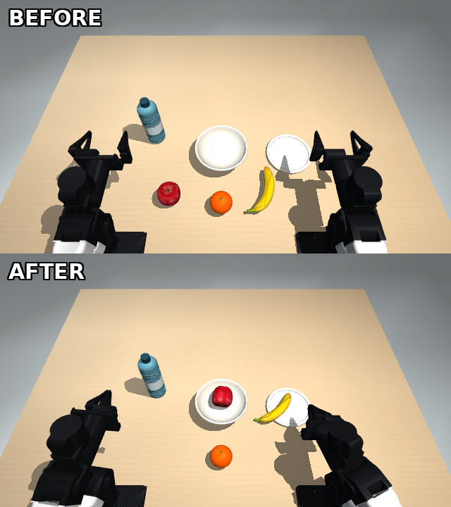
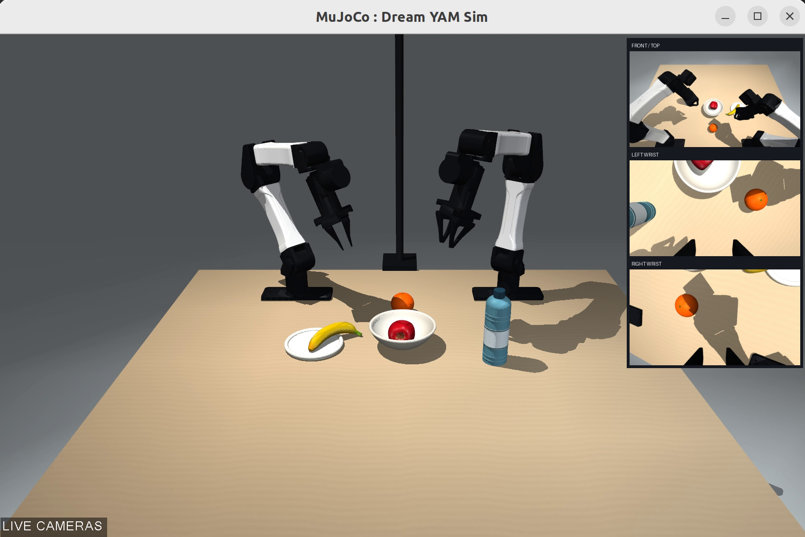
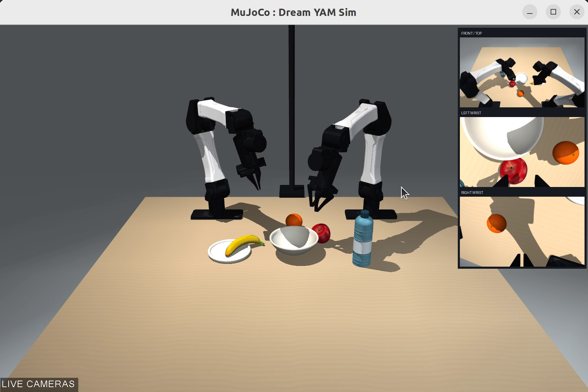
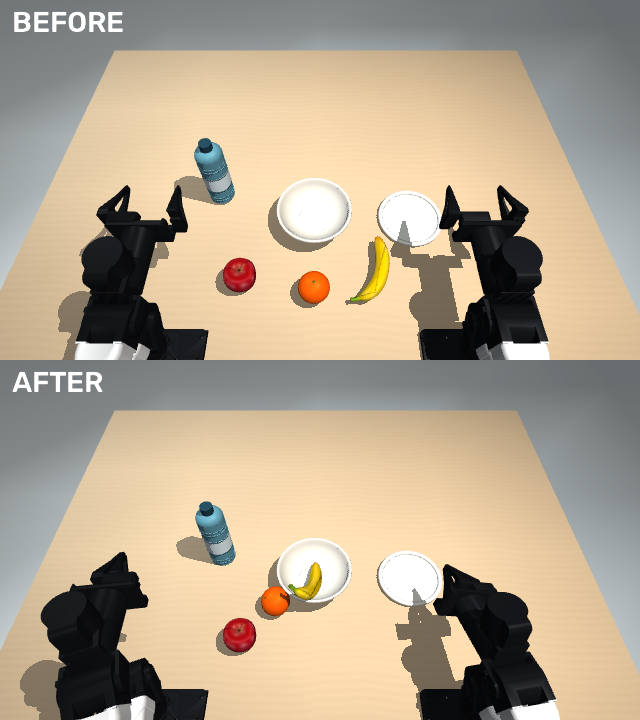
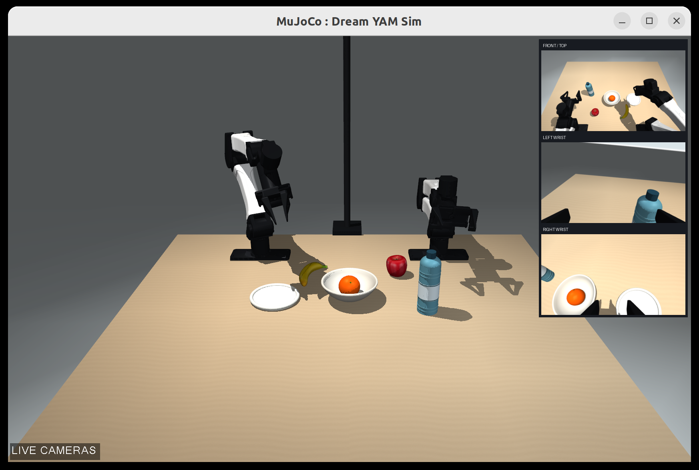
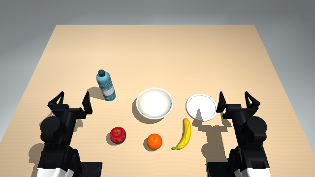
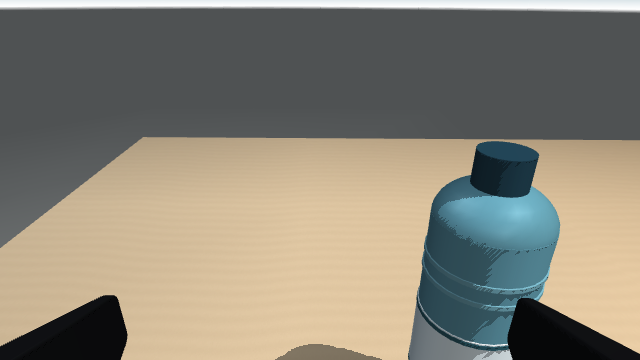

# Dream-1 × YAM in MuJoCo — Bimanual Manipulation Trials

Recorded, measured trials of **Dream Labs' Dream-1** driving a simulated **I2RT YAM bimanual arm** in MuJoCo, plus the Isaac Sim tooling built along the way to drive Dream-1 from other simulators.

<p align="center">
  
  
</p>
<p align="center"><em>Two-object task, "pick up the banana and put it on the plate, then pick up the apple and put it in the bowl". Left: before / after. Right: the MuJoCo viewer with the three live cameras at the end — banana on the plate, apple in the bowl.</em></p>

All three fruits have now been picked up and placed successfully at least once: the **orange** and **banana** by Dream-1 on its own, and the **apple** (plus banana again) in the two-object run with a small set of scripted grip helpers. [Which trials used helpers](#two-modes-pure-policy-vs-assisted) is spelled out below, because it matters for how you read the numbers.

Success is always decided from MuJoCo body poses after the run, never from anything the model says about itself.

---

## Contents

1. [What is Dream-1?](#what-is-dream-1)
2. [Two modes: pure policy vs assisted](#two-modes-pure-policy-vs-assisted)
3. [Results](#results)
4. [Successful grasps](#successful-grasps)
5. [How the code works](#how-the-code-works)
6. [How a trial is scored](#how-a-trial-is-scored)
7. [Repository layout](#repository-layout)
8. [Setup and running](#setup-and-running)
9. [Budget control](#budget-control)
10. [Honest limitations](#honest-limitations)

---

## What is Dream-1?

[Dream Labs](https://dreamlabs.ai/research/dream-1/) released **Dream-1** in October 2026 as a hosted robot foundation model behind a public API (from about $3 per hour of robot time).

- **World Action Model.** It learns how scenes change from video and links that to arm motion, so predicting what the robot should do and imagining what will happen are treated as one problem. It builds on the team's earlier DreamZero research.
- **Zero-shot to new robots.** It was trained on a single robot, the I2RT **YAM**, and is meant to control other bimanual robots with parallel grippers without fine-tuning or demonstrations from that robot.
- **Simple interface.** You send camera frames, the robot state and a natural-language task. You get back the next ~1.6 s of actions as end-effector poses, which a client-side IK solver converts to joint targets for your arm.
- **Scope.** A manipulation policy for bimanual parallel-gripper robots. Dream Labs describes it as a research beta, not validated for safety-critical use.

This repo uses Dream-1 on its native YAM arms (the MuJoCo example shipped with the Dream CLI) and, separately, wires it into Isaac Sim.

---

## Two modes: pure policy vs assisted

Every trial is a real model run: Dream-1 receives the camera images, arm state and a text task, and returns the actions. What differs is whether the trial driver adds help on top.

| Mode | What the driver changes | Used in |
|---|---|---|
| **Pure policy** | Only the simulator's finger strength (`--grasp-boost`). No motion is added or overridden. | The 8 placement tasks and the 5 pick trials |
| **Assisted** | Adds two scripted helpers: `--assist-descent` and `--hold-grip` (see below). | `pickplace1`, `place6`, `both4` |

The helpers exist because, in pure-policy runs, the grippers reached and touched the right fruit but did not close and lift it (see [Results](#results)).

- **`--assist-descent`** — when an arm's grasp site is within `--assist-radius` (8 cm) of a fruit, it adds a small downward Cartesian correction (3–4 mm per step) to that arm's joint targets.
- **`--hold-grip`** — once a fruit's centre sits between a gripper's two finger tips, the gripper command is forced shut and stays shut until the held fruit is over a bowl or plate, then it is forced open. One grasp per arm per trial.

Dream-1 still decides which arm goes where, which fruit to take and where to carry it. But the descent nudge, the grip closing and the release timing in assisted trials are **not** Dream-1's own behaviour.

---

## Results

Model: `dreamlabs/dream-1-beta`. Fresh scene per trial, GUI open, viewer window recorded. Details in [`tasks_report.txt`](tasks_report.txt) and the per-run `trial_*.log` files.

### Phase 1 — placement tasks, pure policy (2 of 8)

| # | Task | Time | Verdict | Measurement |
|---|------|------|---------|-------------|
| 1 | put apple into the bowl | 240 s | FAIL | xy 11.6 cm (limit 6) |
| 2 | put banana on the plate | 240 s | FAIL | xy 20.9 cm (limit 7) |
| 3 | put orange into the bowl | 240 s | **SUCCESS** | xy 0.2 cm, dz +3.7 cm |
| 4 | put apple on the plate | 240 s | FAIL | xy 34.9 cm (limit 7) |
| 5 | put banana into the bowl | 300 s | **SUCCESS** | xy 2.7 cm, dz +6.0 cm |
| 6 | put orange on the plate | 240 s | FAIL | pose drift, xy 832 cm |
| 7 | apple→bowl + banana→plate | 300 s | ERROR | Dream API unreachable at the time |
| 8 | orange→plate + apple→bowl | 300 s | FAIL | apple xy 39.6 cm (limit 6) |

### Phase 2 — pick-only trials, pure policy (0 of 5)

Success was "each named fruit raised more than 5 cm". All five failed. After the probe was fixed (trial 4 onward) the logs show real finger contact: the right gripper had thousands of closing-step contacts with the banana, and the grasp sites ended 2–3 cm from the fruit centres. Raising finger force from 22 N to 80 N and pad friction from 1.6 to 6.0 did not change the outcome, so grip strength was not the limit.

### Phase 3 — pick-and-place with the scripted helpers

| Run | Task | Verdict | Measurement |
|---|---|---|---|
| `pickplace1` | pick up the banana and put it in the bowl | FAIL | xy 7.9 cm (limit 6) |
| `pickplace1` | pick up the apple and put it on the plate | FAIL | xy 21.4 cm (limit 7) |
| `place6` | pick up the banana and put it in the bowl | **SUCCESS** | xy 2.5 cm, dz +5.8 cm |
| `both4` | banana → plate, then apple → bowl | **SUCCESS** | banana xy 1.8 cm, apple xy 0.0 cm |

Several other runs (`apple7`, `rel1`, `place7`, `plate1`, `both2`, `both3`, `both5`) have logs and some media but no recorded verdict: they were stopped by the budget cap or by hand before scoring, so they are not counted either way. `test01` (60 s, banana → plate, no helpers) was too short and failed.

### Every fruit has a recorded success

| Fruit | Successful placement | Mode |
|---|---|---|
| Orange | into the bowl (trial 3), xy 0.2 cm | Pure policy |
| Banana | into the bowl (trial 5); into the bowl (`place6`); onto the plate (`both4`) | Pure policy; assisted; assisted |
| Apple | into the bowl (`both4`) | Assisted only |

---

## Successful grasps

### Both fruits in one run — `both4` (assisted)

Task: *pick up the banana and put it on the plate, then pick up the apple and put it in the bowl.* Dream-1 made 64 requests (3,068 actions) in about 4 minutes.

| Metric | Value |
|---|---|
| Verdict | **SUCCESS** |
| Banana → plate | xy 1.8 cm (limit 7), dz +4.1 cm |
| Apple → bowl | xy 0.0 cm (limit 6), dz +4.5 cm |
| Finger contacts while closing | left 128, right 135 (banana, apple) |
| Closest approach | left→apple 2.1 cm, right→banana 2.8 cm |
| Helpers | descent 4 mm applied 312× left / 1,047× right; grip latched on both arms (345 / 312 steps held shut); released 1× |
| Gripper opening at the end | left 0.95, right 0.96 |


Mid-trial viewer capture, with the front/top, left wrist and right wrist feeds:




Video: [`yam_check/video/both4_clean.mp4`](yam_check/video/both4_clean.mp4) (about 3.4 minutes of the viewer window).

### Banana into the bowl — `place6` (assisted)



Video: [`yam_check/video/pick_up_the_banana_and_put_it_in_the_bowl_1_place6.mp4`](yam_check/video/pick_up_the_banana_and_put_it_in_the_bowl_1_place6.mp4)

### Orange into the bowl — trial 3 (pure policy)

The orange starts on the table between the arms and ends in the bowl, 0.2 cm from its centre.




Video: [`yam_check/video/put_orange_into_the_bowl_1_a3.mp4`](yam_check/video/put_orange_into_the_bowl_1_a3.mp4)

### Banana into the bowl — trial 5 (pure policy)

A longer reach (300 s). The banana ends 2.7 cm from the bowl centre, 6.0 cm above its reference.


Video: [`yam_check/video/put_banana_into_the_bowl_1_a5.mp4`](yam_check/video/put_banana_into_the_bowl_1_a5.mp4)

### Reference camera views

The three cameras Dream-1 sees each step: overhead (head), left wrist and right wrist.

<p align="center">
  
  
  
</p>

---

## How the code works

There are two independent pipelines in this repo.

### Pipeline A: MuJoCo trials (the results above)

```
yam_trials.py
   │  builds yam_env.YamEnv()        (scene: 2 YAM arms, table, apple/orange/banana, bowl, plate, bottle)
   │  optional boost_grasp(env)      (stronger fingers, grippier pads — physics only)
   │  optional assist_descent / hold_grip   (scripted helpers, wrap env.step)
   │  records poses → "pre"
   ▼
dream_control.main(argv, shared_env=env)      ← Dream's own control loop
   │  sends: 3 camera frames + arm state + task text  ──►  Dream-1 API
   │  receives: action chunk (end-effector poses → joint targets via client IK)
   │  executes at ~20 Hz with Dream's action validation
   ▼
yam_trials.py
   │  records poses → "post"
   │  evaluate(task, pre, post)  → SUCCESS / FAIL
   │  saves before/after PNGs, proof sheet, GUI screenshot, mp4, report entry
```

Key pieces in [`yam_trials.py`](yam_trials.py):

| Function / class | What it does |
|---|---|
| `poses(env)` | Reads world positions of the three fruits, bowl and plate from MuJoCo body state. |
| `boost_grasp(env)` | Raises the finger actuator force limit and finger-pad friction. Sim physics only; it does not move the arm. |
| `assist_descent(env, dz, radius)` | **Scripted.** Wraps `env.step`; when a grasp site is within `radius` of a fruit, adds a small downward Jacobian-based correction to that arm's joints and counts the steps. |
| `hold_grip(env, between_tol)` | **Scripted.** Wraps `env.step`; latches the gripper command shut when a fruit is between the finger tips, and opens it once the fruit is over a bowl or plate. |
| `evaluate(task, pre, post)` | Parses fruit and receptacle from the task text, measures `dxy`, `dz`, and decides success against the receptacle radius. |
| `Recorder` | Watches the X tree for the new MuJoCo viewer window, records it with `ffmpeg x11grab` at 10 fps, and takes a mid-trial GUI screenshot. |
| `contact_sheet(...)` | Stacks the before and after top-camera frames into the `_proof.png` image. |
| `grasp_probe(env)` | Wraps `env.step` and counts finger↔fruit contacts while a gripper is closing. |
| `main()` | CLI: loops tasks and trials, resets the scene, runs the Dream loop, scores, saves artefacts, appends to the report. |

### Pipeline B: Isaac Sim bridge (dual Franka and YAM import)

Isaac Sim ships its own Python (3.11), while the Dream client lives in a separate environment (3.12). A localhost socket bridges them:

```
Isaac Sim process (python.sh)                    dream-env process (Python 3.12)
run_dream1_isaac.py / run_yam_isaac.py   ◄────►  dream_bridge.py  ──►  Dream-1 API
  scene + 3 cameras                      127.0.0.1:6006               budget.Ledger (spend cap)
  executes returned chunks               multiprocessing.connection   dashboard.py (Tk UI)
```

Message protocol between the two (`dream_bridge.py`):

| Command | Meaning |
|---|---|
| `reset` | Start a new episode on the Dream client. |
| `obs` | Send camera frames (as `video.<role>`), joint state and the prompt. |
| `act` | Charge the ledger, call `get_action`, return `q_r_chunk` and `q_l_chunk` (48 rows = 1.6 s each). Cold models answer `pool_warming`; the bridge waits and retries without being billed. |
| `quit` | Close the connection. |

Supporting modules:

- [`embodiment_config.py`](embodiment_config.py): builds the `policy()` config, including the body layout (6 joints per arm for YAM, 7 for Franka) and the `ik` block that makes the client convert end-effector poses to joints.
- [`budget.py`](budget.py): per-call ledger (`cap_usd`, `max_calls`), charged *before* every paid request so failures still count.
- [`tasks.py`](tasks.py): task table for the dual-Franka tabletop scene (red/blue cubes, green/yellow bins).
- [`dashboard.py`](dashboard.py): Tk dashboard with the three camera feeds, robot state, ledger and logs.
- [`find_yam_home.py`](find_yam_home.py), [`test_yam_import.py`](test_yam_import.py), [`test_yam_import2.py`](test_yam_import2.py): import the YAM URDF into Isaac Sim, find a good home pose, and export `yam_left.usd`, `yam_right.usd`, `yam_probe.usd`.
- [`check_setup.py`](check_setup.py): free preflight (API key, checkpoint, arm file, IK build, ledger). Makes no inference calls.

---

## How a trial is scored

- `dxy`: horizontal distance between the fruit body and the receptacle body (m, shown in cm).
- `dz`: vertical offset of the fruit above the receptacle body.
- **Placement success:** `dxy < radius` and `-0.04 < dz < 0.12`, with bowl radius 0.060 m and plate radius 0.070 m.
- **Pick success (phase 2):** each named fruit raised more than 5 cm above its start height.
- For two-object tasks, the report lists each fruit's placement separately.
- Success is measured from simulator state after the run, not from the model's output.

---

## Repository layout

```
yam_trials.py            trial driver: GUI, recorder, grasp boost, scripted helpers, probe, scoring
yam_budget_runner.py     time-based budget wrapper (also launches yam_trials.py via --cmd)
budget.py                per-call credit ledger used by the bridge
yam_ledger.json          time ledger (seconds run, cap, rate, estimated spend)
dream_bridge.py          Isaac ↔ Dream socket bridge
embodiment_config.py     Dream policy/embodiment config (YAM 6 DoF, Franka 7 DoF)
run_dream1_isaac.py      Isaac Sim dual-Franka scene driven by Dream-1
run_yam_isaac.py         Isaac Sim scene with Dream's own YAM arms
dashboard.py             Tk operator dashboard
tasks.py / tasks.txt     task tables (Isaac scene / MuJoCo prompts)
check_setup.py           free preflight check
find_yam_home.py, test_yam_import*.py   YAM URDF import utilities
yam_left/right/probe.usd YAM arm assets for Isaac
run_isaac_clean.sh       Isaac python with a scrubbed environment
run_yam_demo.sh          launch Dream's YAM sim through the budget wrapper
kill_isaac.sh            kill leftover Isaac runs and bridges
tasks_report.txt         verdicts, measurements, follow-up notes and corrections
trial_*.log              raw console log of each assisted / follow-up run
yam_check/video/         GUI screen recordings (x11grab), one per run
yam_check/trials/        *_before_top, *_after_top, *_proof, *_gui PNGs per run
yam_check/frames/        reference top / left / right camera frames
gh_upload.py, upload_picks.py, UPLOAD_NOTES.md   how artefacts were pushed to GitHub
```

---

## Setup and running

Requirements: a Dream API key (stored by the Dream CLI in `~/.dreamlabs/credentials`), the `dream` Python package with its `dream_examples/yam_mujoco` example, MuJoCo, `ffmpeg`, ImageMagick (`import`, `xwininfo`) and an X display for the GUI capture. Paths in the scripts assume a `~/dream-env` virtualenv; adjust `EXAMPLE` in `yam_trials.py` to your install.

**Pure-policy trial with GUI and recording:**

```bash
export DISPLAY=:1
MUJOCO_GL=glx ~/dream-env/bin/python yam_trials.py \
    --viewer \
    --video-dir yam_check/video \
    --report tasks_report.txt \
    --task "put orange into the bowl" \
    --seconds 240 \
    --grasp-boost
```

**Assisted two-object trial (the `both4` setup):**

```bash
MUJOCO_GL=glx DISPLAY=:1 ~/dream-env/bin/python yam_trials.py \
    --viewer --video-dir yam_check/video --report tasks_report.txt --tag both4 \
    --task "pick up the banana and put it on the plate, then pick up the apple and put it in the bowl" \
    --seconds 245 \
    --grasp-boost --assist-descent 0.04 --hold-grip
```

Flags: `--task` (repeatable), `--trials`, `--actions` (default 48 per request), `--tag`, `--frames`, `--video-dir`, `--report`, `--grasp-boost`, `--assist-descent METRES`, `--assist-radius METRES`, `--hold-grip`.

**Free preflight (no credits spent):**

```bash
~/dream-env/bin/python check_setup.py
```

**Isaac Sim with Dream's YAM arms (two terminals):**

```bash
# terminal 1 (dream-env)
python dream_bridge.py --arm yam --cap-usd 5 --max-calls 300

# terminal 2
./run_isaac_clean.sh run_yam_isaac.py --max-calls-per-ep 60
```

Use `python dream_bridge.py --mock` and `--dump-frames` for free dry runs.

---

## Budget control

Two independent brakes protect the account:

- `yam_budget_runner.py` bounds MuJoCo sessions by **time** at $3/h and refuses to start past the cap. The default cap is $5.00; later sessions raised it with `--cap-usd` (5.60, 5.85, 6.35, 6.70 appear in the logs). `yam_ledger.json` is the source of truth and currently records 7,876 s, about $6.56 of a $6.80 cap.
- `budget.py` bounds Isaac sessions per **call** (`cap_usd` and `max_calls`); one call returns 1.6 s of actions, roughly $0.0013.

---

## Honest limitations

- **Pure Dream-1 did not pick-and-lift reliably.** In phase 2, 0 of 5 trials lifted a fruit even though the grippers reached and touched the right objects. The only pure-policy successes are the orange and banana bowl placements in phase 1.
- **The apple success depends on scripted helpers.** The `both4` and `place6` results use `--assist-descent` and `--hold-grip`. In assisted runs 2 of 4 scored attempts succeeded (`pickplace1` failed twice).
- **`both4` was scored after the budget cap interrupted the script.** Dream-1 finished its run (64 requests), then the budget runner stopped the process while the script was saving its after-image, so the report entry was written separately rather than by the script's own `evaluate()` call. The before/after images and the video show the final state.
- **Early grasp numbers were a bug, not evidence.** Trials 1–8 and pick trials 1–3 printed "0 contacts"; that was a name-matching bug in the probe. Also, in those runs the pad-friction part of `--grasp-boost` changed 0 pads (only the ±40 N servo limit applied). The report's CORRECTION note covers this. From pick trial 4 on, contacts are real.
- Trial 6's 832 cm pose drift points to a simulation instability, not a real placement. One earlier two-object trial failed because the Dream API was unreachable.
- Each trial is a single run, so these numbers are a small sample, not a benchmark.
- **Reproducing `place6` / `both4` exactly:** their logs show stronger settings (fingers ±80 N, pad friction 8.0, fruit friction 4.0) than the flags in the committed `yam_trials.py` expose, and the committed `assist_descent` has a disabled setup block (`if False:`) for the joint indices, limits and gripper body, which that function needs when it fires. Treat the committed script as the older version of what produced those two runs.

## Notes

Large binaries were pushed through the GitHub Contents API, which rejects bodies over about 40 MB, so some videos are re-encoded copies (1280 px, H.264 CRF 23); see [`UPLOAD_NOTES.md`](UPLOAD_NOTES.md).

Dream-1 and Dream Labs are the property of their respective owners; this repo is an independent set of trials.
